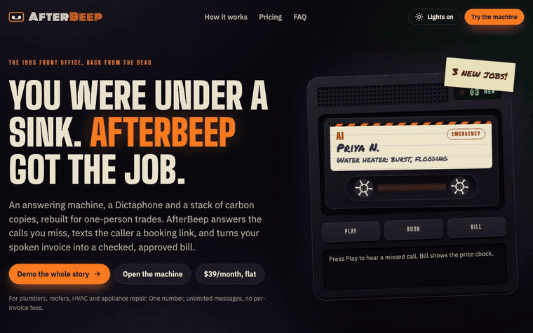
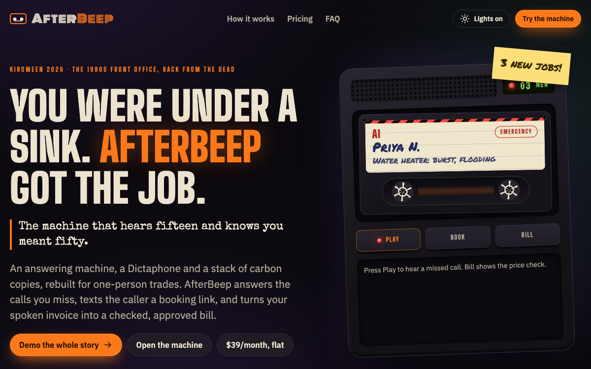
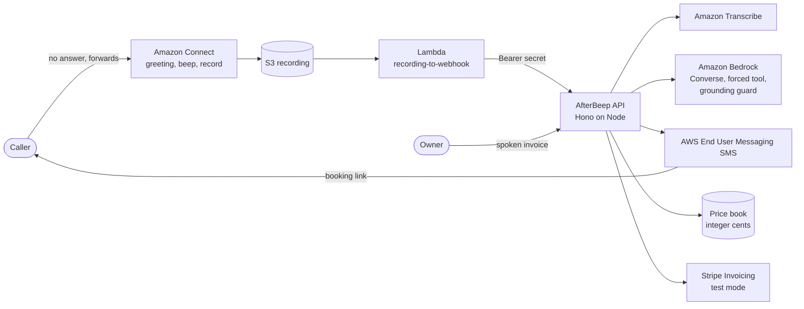

# AfterBeep

**Kiroween 2026 · Resurrection** · [](https://github.com/blackwingArtisan/afterbeep/actions/workflows/check.yml) · MIT

### The machine that hears fifteen and knows you meant fifty.

The 1985 front office, back from the dead, for one-person trade businesses. **The answering machine** answers the calls a plumber misses under a sink and texts every caller a booking link. **The Dictaphone** turns a spoken invoice into line items. **The carbon copies** remember what you charge, so "dryer belt, fifteen" is held until you confirm you meant $50. One plan, $39 a month.

**Live demo:** link added at deploy · **Video:** link added at submission



## Try it in 60 seconds
Requires Node 24 or later. No accounts or keys.

1. `npm ci && npm run build && npm start`, then open http://localhost:3111.
2. On the landing page, press **Play** on the machine: it rings, types a burst water heater voicemail and shows the text the caller got back. Press **Bill** to see a misheard price held.
3. Press **Demo the whole story**. A call places itself and ends with June's tape and the exact text she was sent.
4. **Open the text as June**, pick a time, book.
5. **Back to Morgan: bill it by voice.** Line it up, use the usual $50.00, approve and send. The invoice is stamped SENT.
6. Open **Messages**: "Kept this week" now counts the booking and the $35 the price check caught.

## What a missed call costs

| | | Source |
|---|---|---|
| Callers who reach voicemail and hang up | **69%** | Moneypenny call report, 2016 |
| Micro businesses that fail to answer their calls | **1 in 3** | Moneypenny call report, 2016 |
| Typical minor appliance repair | **$206** | Thumbtack, 2026 |
| Typical emergency plumbing call | **$377** | Thumbtack, 2026 |
| US plumbing, HVAC and electrical contractors with no employees | **362,219**, up 10% since 2019 | US Census Bureau, Nonemployer Statistics 2023 |

Five missed calls a week, one in three booked at $206, is about **$1,490 a month** of work that would have gone to the next name on the search page. One booked job pays for five months of AfterBeep. Sources, assumptions and the full model: [docs/business.md](docs/business.md).

## Business

- **Price:** $39 a month, flat, 14-day free trial, no per-call or per-invoice fees.
- **Cost to serve on AWS:** about **$0.074 per call** (Connect, Transcribe, Bedrock Nova Lite, a two-segment text back and a confirmation) plus $3.90 a month for the number and 10DLC registration. Gross margin is **80% at 50 calls a month** and **52% at 200**. Texts are two-thirds of the cost, so shorter texts are the main lever.
- **Market:** 1% of the solo building-equipment contractors alone is about $1.7 million a year.
- **Go to market:** no new number (conditional call forwarding on the phone they already carry), supply-house counter cards with a "call this and leave a message" QR code, trade forums, and a free month per referral.

## Why not iPhone Live Voicemail, Google Voice, Jobber, Podium or Smith.ai?

| Option | Price | What it leaves undone |
|---|---|---|
| iPhone Live Voicemail | Free | Shows the message; no text back, no booking, no invoice |
| Google Voice | $10-$30 per user a month | Transcribes; no booking link, no schedule, no price checks |
| Jobber | Core $29-$49 a month, AI Receptionist +$29 | A whole field-service suite to move into; invoices do not check a spoken price against your history |
| Podium | Quote from sales | Built for multi-location businesses |
| Smith.ai AI Receptionist | Free for 25 calls, then $150 a month for 75 | Priced per call, answers as a receptionist, no invoices |

A transcript is free now. What a solo tech still lacks is what happens after the beep: the text back, the booking, and a bill that cannot go out wrong.

## Screens

| Landing | The call | The hold |
|---|---|---|
|  |  |  |

| The caller's phone | Sent | The inbox |
|---|---|---|
|  |  |  |

## What works today
Everything runs on a laptop with no accounts. Each item is covered by the tests below.

**The answering machine**
- Reads each voicemail for the caller's name, callback number (a spoken number beats caller ID), address, job and urgency. A furnace that quit at twenty degrees with a baby at home is an emergency; no hot water is "soon".
- Texts every real caller a booking link at once. Emergencies are promised a call back; everyone else sees the first open slot. Hang-ups get no text, a repeat caller gets one text per 10 minutes, and a text the carrier refuses is filed with a retry button.
- The booking page offers real open slots in the business's time zone, lets the caller correct the address, and texts a confirmation.
- The inbox shows each message as a cassette, emergencies first under a "Call back now" strip, with a seven-segment counter and a "Kept this week" readout.

**The Dictaphone and the carbon copies**
- "Dryer belt fifteen, taxed. One hour labor at eighty-five. Trip charge." becomes three lines. Code does every multiplication, the tax and the total in integer cents.
- A price book built from past invoices holds a price more than 15% below or 25% above the usual one, fills a missing price from history, reads "twelve fifty" as $1,250 for a water heater, and keeps "forty gallon" as a size, not a quantity.
- Quantities are checked too, and a price with two readings and no history waits for the owner to pick one.
- The server recomputes the total and sends only when it equals the exact total the owner approved.

## Architecture



Every outside service sits behind a port with a free local default, so the demo and all tests run with no accounts. The real adapters are type-checked and loaded only by environment variable.

| Port | Env var | Local (default) | Real |
|---|---|---|---|
| Transcriber | `AFTERBEEP_TRANSCRIBER` | `local`: the browser transcript | `aws`: Amazon Transcribe on the S3 recording |
| Extractor | `AFTERBEEP_EXTRACTOR` | `rules`: deterministic rules | `bedrock`: Bedrock Converse with a forced tool; drops any number or address the caller never said; falls back to rules |
| SMS | `AFTERBEEP_SMS` | `outbox`: shown at `/machine/outbox` | `aws`: AWS End User Messaging SMS |
| Invoices | `AFTERBEEP_INVOICES` | `local`: outbox message and `/i/:id` page | `stripe`: test keys only; voids the invoice if Stripe's total differs |
| Store | `AFTERBEEP_DATA_DIR` | JSON file with atomic writes | |

```
src/domain/     pure logic: money, spoken numbers, tax, invoice parser, price book, voicemail rules, slots, kept stats
src/adapters/   ports and implementations: store, transcriber, extractor, sms, invoices
src/server/     Hono API, services (voicemail, booking, invoicing), seed data
src/client/     React app: landing, machine (inbox, call, schedule, invoice, outbox, prices), caller pages
infra/connect/  Amazon Connect contact flow and Lambda for the real phone path
.kiro/          steering, specs, hooks, MCP settings
```

The phone wiring is in [infra/connect/README.md](infra/connect/README.md). All settings are listed in `.env.example`.

## Tests and spec traceability

```bash
npm run check             # typecheck, spec coverage, 135 Vitest unit and API tests
npx playwright install chromium
npm run test:e2e          # 15 Playwright tests against the production build on port 3112
```

Every test title names the EARS requirements it proves, such as `[VI 3.4, 3.7] holds a labor rate well below the usual rate`. `npm run spec:coverage` fails the build when a requirement has no test: today 85 of 89 are named by tests, and the other 4 are on the real AWS and Stripe path. CI runs all of it on every push.

`npm run eval` scores the rules extractor on 24 hand-labelled voicemails it had not seen: on the first run it got every phone number and address right, never invented an address, and read urgency right in 19 of 24. The two missed emergencies it found are fixed, and urgency is now 21 of 24. Details and the remaining misses: [docs/eval.md](docs/eval.md).

## Demo mode and deploy
The call simulator and **Reset demo** need no login, so they run only in demo mode. Demo mode is on by default while every adapter is local and turns off by itself when any real adapter is selected; set `AFTERBEEP_DEMO=off` before any deploy that holds real customer data. The owner screens have no login yet: this build is a single-tenant demo. `render.yaml` describes a one-service deploy with local adapters.

For development with hot reload: `npm run dev` (client on 3110, API on 3111).

## Built with Kiro
Kiro steering, specs, hooks and MCP settings live in [`.kiro/`](.kiro). [KIRO-LOG.md](KIRO-LOG.md) maps each Kiro feature to the files that use it and says which were written by Kiro and which by hand.

- **Steering:** product, tech and structure rules always included; money rules load with domain files and AWS rules with adapters; a manual demo script.
- **Specs:** two features in EARS form, 89 criteria, every task checked off and traced to tests. A Kiro review against the code added four criteria the code already met.
- **Hooks:** unit tests on save, a money-rules guard, spec sync, a copy review, and typecheck plus build checks when the agent stops.
- **MCP:** AWS documentation and Context7.

## License
MIT, Stubborn Otter Software. All people, businesses, addresses and phone numbers in the demo data are invented.
