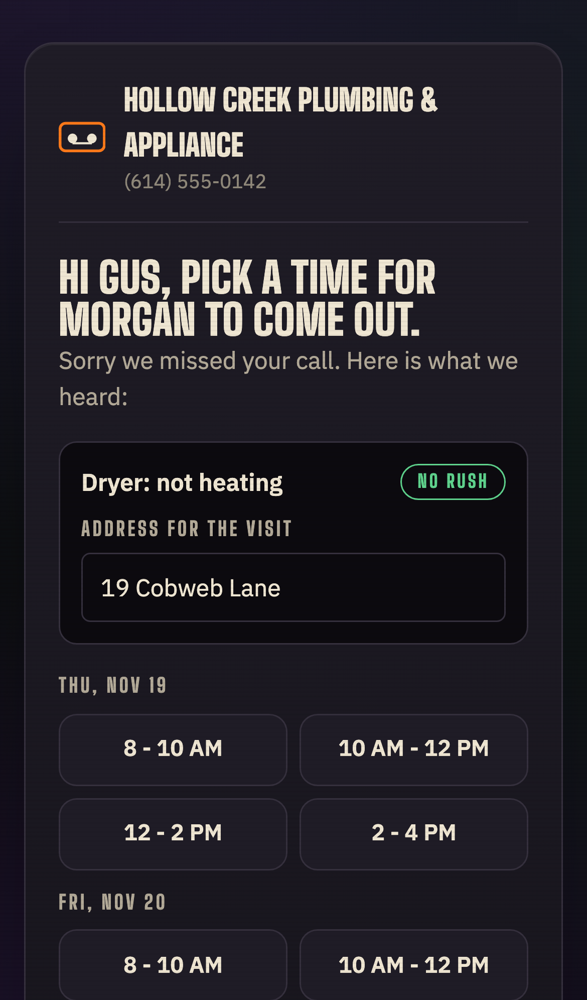
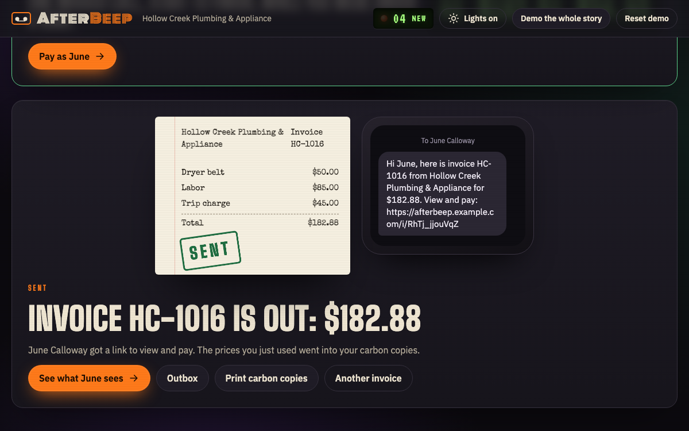
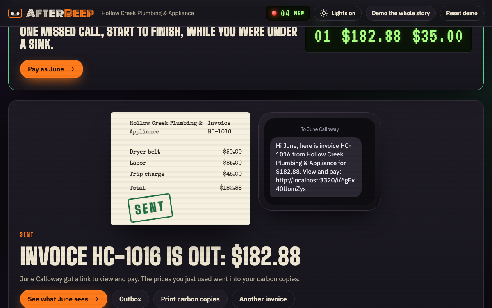
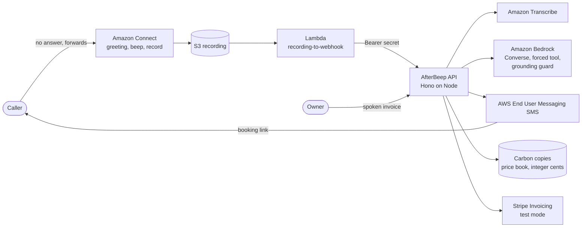

# You were under a sink. AfterBeep got the job.

**Kiroween 2026 · Resurrection** · [](https://github.com/blackwingArtisan/afterbeep/actions/workflows/check.yml) · MIT · [Judge's map](docs/judging.md)

> **Try it live: [afterbeep.pages.dev](https://afterbeep.pages.dev)** · press **Demo the whole story** · remote code **4-2-7** (open **Remote**, press **Call your machine**)
>
> The live demo is a shared sandbox with invented data. It sends no real texts (they land in the Outbox) and resets itself every day. The Amazon Connect phone number is not live yet.

**Miss five calls a week and about $740 of work a month walks to the next name on the list.** AfterBeep answers the calls a one-person trade business misses, texts the caller a booking link, and turns a spoken invoice into a checked bill. One plan, $39 a month.

### The machine that hears fifteen and knows you meant fifty.


## Why it matters

- **A resurrection of three dead machines.** The answering machine, the Dictaphone and the carbon-copy invoice book were the solo trade's front office until the cell phone folded them into a beep. AfterBeep brings all three back, and this time they book the job and check the bill.
- **A real AWS path, not a mock-up.** Amazon Connect, Transcribe, Bedrock and End User Messaging sit behind tested ports, with a SAM template validated in CI. Everything also runs on a laptop with no accounts.
- **A business that pays.** $39 a month flat, about $0.074 a call on AWS, an 80% gross margin at 50 calls a month, and 362,219 solo plumbing, HVAC and electrical contractors who cannot pick up.

## Try it in 60 seconds
Requires Node 24 or later. No accounts or keys.

1. `npm ci && npm run build && npm start`, then open http://localhost:3111.
2. On the landing page, press **Play** on the machine: it rings, types a burst water heater voicemail and shows the text the caller got back. Press **Bill** to see a misheard price held.
3. Press **Demo the whole story**. A call places itself and ends with June's tape and the exact text she was sent.
4. **Open the text as June**, pick a time, book.
5. **Back to Morgan: bill it by voice.** Line it up, use the usual $50.00, approve and send. The invoice is stamped SENT.
6. The story ends on a finale (1 booked, $182.88 billed, $35.00 caught). Press **Pay as June** and PAID slams onto her invoice.
7. **Back to the machine: raise the dead.** Last week's five hang-ups wait in the graveyard as ghost cassettes. One press texts each a booking link, and they rise.
8. Open **Messages**: "Kept this week" now reads Morgan's Tuesday: 2 booked, $557 of booked work, $35 caught, paid for itself 14 times.
9. **Call in from the truck.** Open **Remote**, press **Call your machine** and key 4-2-7: "You have N new messages." Press 1 to play, 2 to text the caller the booking link, # for the next, 9 twice to erase. Then "After the beep, say your invoice" opens a held draft. (Built by Kiro. On a real phone the owner calls the business number from their own phone and keys the same code; the Connect flows and the turn Lambda are written and tested, not deployed.)

> **Built with Kiro**
> - **Remote retrieval was built by Kiro:** kiro-cli wrote the spec (124 EARS criteria, design, 41 tasks) and then the code, tests, Amazon Connect flows and the turn Lambda for a real phone, task by task, in eight sessions and about 5,500 lines. Claude Code ran the shell, fixed one 15-line layout bug and two single lines. Prompts, output and credits: [docs/kiro-sessions/](docs/kiro-sessions)
> - **6 steering files:** 3 always included, 2 loaded by file match (money rules with `src/domain`, AWS rules with `src/adapters`), 1 manual demo script
> - **3 specs, 243 EARS criteria:** 239 named by test titles and enforced in CI by `npm run spec:coverage`, 4 on the real AWS and Stripe path
> - **6 IDE hooks** (4 on file save, 2 on agent stop) and **1 custom agent** with 3 hooks of its own: a guard that blocks `.env` writes, live Stripe keys and float money, and tests after every source write
> - **3 MCP servers:** AWS documentation and Context7, pinned, plus AfterBeep's own (spec coverage, price-book lookup, greeting check)
> - How Kiro and the coding assistant split the work, and every time Kiro caught something: [KIRO-LOG.md](KIRO-LOG.md)

## What died
A one-truck business used to run on three machines: an answering machine on the kitchen counter, a Dictaphone in the truck and a carbon-copy invoice book on the dash. The cell phone folded all three into a beep and a red badge. Voicemail promises the caller nothing, nobody types up the invoice until midnight, and there is no yellow copy to say what you charged last time.

|  |  |  |
|:---:|:---:|:---:|
| **The answering machine**<br>answers, reads and texts back | **The Dictaphone**<br>a spoken invoice becomes line items | **Carbon copies**<br>remember what you charge |

**The honest machine.** No robot pretending to be your receptionist. AfterBeep plays your own greeting, says it is a machine, takes the message and texts your real open times.

## What a missed call costs

**Plain voicemail loses 69% of callers. AfterBeep's greeting promises a text with open times in seconds, so callers have a reason to stay**, and every one who leaves a message gets a booking link before they dial the next name on the list.

**Payback, with the assumptions labelled.** Five missed calls a week is about 22 a month. Plain voicemail keeps 31% of them as messages. *Assume* a greeting that promises a text keeps half, and *assume* one in three of those callers books at Thumbtack's typical $206: that is about **$740 a month** of booked work, or **18 times** the $39 price. The landing page lets you move both assumptions.

**The Dictaphone and the carbon copies pay too.** *Assume* one misheard price a week at the $35 gap between "fifteen" and the usual fifty: that is about **$1,800 a year** kept on invoices that would have gone out short.

**Morgan's Tuesday** (a scenario built on the demo data, so the app shows the same numbers). Four calls roll to the machine while Morgan is under a water heater, and every caller gets a text with open times in seconds. Priya's burst water heater books at a $377 quote, and June's dryer visit is billed at $180 before tax ($182.88 with it) after the carbon copies hold "dryer belt, fifteen" at the usual $50. Kept this week: **2 jobs booked, $557 of booked work ($377 quoted + $180 billed), $35 caught, paid for itself 14 times.**

<details>
<summary>The cited figures</summary>

| | | Source |
|---|---|---|
| Callers who reach voicemail and hang up without a message | **69%** | Moneypenny call report, 2016 |
| Customers whose calls go unanswered who will not call back | **up to 85%** | CallRail small business benchmark, 1.1 million leads, 2025 |
| Home services calls that go unanswered | **14%** | CallRail, same benchmark |
| Typical minor appliance repair | **$206** | Thumbtack, 2026 |
| Typical emergency plumbing call | **$377** | Thumbtack, 2026 |
| US plumbing, HVAC and electrical contractors with no employees | **362,219**, up 10% since 2019 | US Census Bureau, Nonemployer Statistics 2023 |

</details>

## Business

- **Price:** $39 a month, flat, 14-day free trial, no per-call or per-invoice fees.
- **Cost to serve on AWS:** about **$0.074 per call** plus $3.90 a month for the number and 10DLC registration. Gross margin is **80% at 50 calls a month** and **52% at 200**.
- **Market:** 362,219 solo plumbing, HVAC and electrical contractors at $468 a year is about **$170M a year**. About 2,140 customers make $1M a year.
- **Startup math, assumptions labelled:** 3% monthly churn gives a lifetime value of about $1,040 at the 80% margin. Counter cards and referrals at an assumed $150 to win a customer pay back in under five months.
- **First 12 months:** 10 techs at one supply house, then that metro, then three metros.
- **Go to market:** no new number (conditional call forwarding on the phone they already carry), supply-house counter cards with a "call this and leave a message" QR code, trade forums, and a free month per referral.

Sources and the full model: [docs/business.md](docs/business.md). Opt-outs, 10DLC and Raise the dead: see "Texting rules" further down.

**Text-back is table stakes. Of the tools below, only AfterBeep checks a spoken price against your own carbon copies, at $39 flat on your own number.**

<details>
<summary>Why not Live Voicemail, Google Voice, Jobber, Housecall Pro, GoHighLevel, Podium, ServiceTitan or an AI receptionist?</summary>

Prices checked November 18, 2026.

| Option | Price | Answers as | What it leaves undone |
|---|---|---|---|
| iPhone Live Voicemail | Free | Your voicemail | Shows the message; no text back, no booking, no invoice |
| Google Voice | $10-$30 per user a month | Your voicemail | Transcribes; no booking link, no schedule, no price checks |
| Jobber | Core $29-$49 a month, AI Receptionist +$29 | An AI receptionist (add-on) | A whole field-service suite to move into; invoices do not check a spoken price against your history |
| Housecall Pro | Basic $79 a month ($59 billed yearly), 1 user | An AI call-answering add-on, price not published | A suite to move into; no spoken-price check |
| GoHighLevel | Starter $97 a month, plus metered phone and text usage | Your voicemail, with a missed-call text-back setting | A marketing platform built for agencies; no invoices from speech, no price checks |
| Podium | Not published; quote from sales | An "AI employee" add-on | Built for multi-location businesses |
| ServiceTitan | Not published; quote from sales | Your office staff, with phone add-ons | Built for larger shops with dispatchers |
| AI receptionists for trades, such as Rosie | From $49 a month for 250 minutes | A named voice agent | Answers live, but no invoices and no price checks |
| Smith.ai AI Receptionist | Free for 25 calls, then $150 a month for 75 | An AI receptionist, with human backup | Priced per call, no invoices |
| **AfterBeep** | **$39 a month, flat** | **Your greeting, and it says it is a machine** | |

</details>

## Screens

| Landing | The call | The hold |
|---|---|---|
|  |  |  |

| The caller's phone | Sent | The inbox |
|---|---|---|
|  |  |  |

| The finale | Paid | Raise the dead |
|---|---|---|
|  |  |  |

<details>
<summary>What works today</summary>

Everything runs on a laptop with no accounts. Each item is covered by the tests below.

**The answering machine**
- Reads each voicemail for the caller's name, callback number (a spoken number beats caller ID), address, job and urgency. A furnace that quit at twenty degrees with a baby at home is an emergency; no hot water is "soon".
- Texts every real caller a booking link at once. Emergencies are promised a call back; everyone else sees the first open slot. Hang-ups get no text, a repeat caller gets one text per 10 minutes, and a text the carrier refuses is filed with a retry button.
- **Spanish callers.** A message left in Spanish is read for the same details, filed with an English job and summary and an ES chip, and the caller's text back and booking confirmation go out in Spanish. Try the "Burst water heater, in Spanish" sample in the call simulator. About 1 in 8 US residents speak Spanish at home, and in 2025 30% of plumbers were Hispanic or Latino ([sources](docs/business.md#why-now)).
- **The outgoing message.** The owner types or says the greeting, plays it back with the ring and the beep, and sees live checks: says it is a machine, promises a text, asks for name, address and the problem, under 25 seconds. A greeting that claims a person is on the line is refused. The next call plays the saved greeting.
- The booking page offers real open slots in the business's time zone, lets the caller correct the address, and texts a confirmation.
- The inbox shows each message as a cassette, emergencies first under a "Call back now" strip, with a seven-segment counter and a "Kept this week" readout.
- **Raise the dead.** Unreturned hang-ups from the last 30 days wait in a graveyard, one per number. One owner press texts each a single booking link that names the day they called; nothing goes out without the press, and a raised call is never texted twice.
- The phone webhook compares its secret in constant time and files a retried call only once.
- **Texting rules.** Every first text ends "Reply STOP to opt out." A caller who replies STOP (or UNSUBSCRIBE, CANCEL, PARAR and the rest of the common set) gets one confirmation and is never texted again until they reply START; HELP gets the business name and phone. Replies arrive on a signed webhook, and an ordinary reply such as "please don't stop by before 5" changes nothing.

**The Dictaphone and the carbon copies**
- "Dryer belt fifteen, taxed. One hour labor at eighty-five. Trip charge." becomes three lines. Code does every multiplication, the tax and the total in integer cents.
- The carbon copies, a price book built from past invoices, hold a price more than 15% below or 25% above the usual one (the owner's last four slips for the item fan out under the line, with the heard "$15?" scrawled in red), fill a missing price from history, read "twelve fifty" as $1,250 for a water heater, and keep "forty gallon" as a size, not a quantity.
- Quantities are checked too, and a price with two readings and no history waits for the owner to pick one.
- The server recomputes the total and sends only when it equals the exact total the owner approved. The invoice number and the job are reserved before the send, so two sends at once cannot share a number, and invoices are dated in the business's own time zone.

</details>

<details>
<summary>Texting rules: opt-outs, 10DLC and Raise the dead</summary>

- **Opt-out on every number.** Each first text names the business and ends with how to opt out, in the caller's language. STOP-type replies go on an opt-out list that every send checks first: the text-back, the booking confirmation and Raise the dead. AWS End User Messaging keeps its own opt-out list per number as well, so production has two locks.
- **Registered sending.** In the US, business texts from a local number go through A2P 10DLC registration: a registered brand and a campaign that says what the texts are for. AfterBeep's are customer care: replies to people who called the business first, with no marketing content.
- **Raise the dead is a one-time reply.** It texts only numbers that called the business in the last 30 days and never heard back. The owner presses it; each number gets one text, never a second, and numbers that opted out are left out.
- **Nothing on autopilot to strangers.** The machine never texts a number that did not call, and never sends a follow-up sequence.

</details>

## Architecture



Every outside service sits behind a port with a free local default, so the demo and all tests run with no accounts. The real adapters are type-checked and loaded only by environment variable.

| Port | Env var | Local (default) | Real |
|---|---|---|---|
| Transcriber | `AFTERBEEP_TRANSCRIBER` | `local`: the browser transcript | `aws`: Amazon Transcribe on the S3 recording |
| Extractor | `AFTERBEEP_EXTRACTOR` | `rules`: deterministic rules | `bedrock`: Bedrock Converse with a forced tool; drops any number or address the caller never said; falls back to rules |
| SMS | `AFTERBEEP_SMS` | `outbox`: shown at `/machine/outbox` | `aws`: AWS End User Messaging SMS |
| Invoices | `AFTERBEEP_INVOICES` | `local`: outbox message and `/i/:id` page | `stripe`: test keys only; voids the invoice if Stripe's total differs |
| Store | `AFTERBEEP_DATA_DIR` | JSON file with atomic writes | |

```
src/domain/     pure logic: money, spoken numbers, tax, invoice parser, price book (carbon copies), voicemail rules, Spanish glossary, texting rules, greeting checks, slots, kept stats, graveyard, payback, story caller IDs
src/adapters/   ports and implementations: store, transcriber, extractor, sms, invoices
src/server/     Hono API, services (voicemail, texting, booking, invoicing, revive, greeting), seed data
src/client/     React app: landing, machine (inbox, call, greeting, schedule, invoice, outbox, prices), caller pages
scripts/        spec coverage, extractor eval, the Kiro agent's hook scripts, and the project's MCP server
infra/          SAM template for the real phone path; connect/ holds the contact flows and Lambdas
.kiro/          steering, specs, hooks, MCP settings and the afterbeep-builder agent
```

The phone wiring is in [infra/connect/README.md](infra/connect/README.md), and [infra/template.yaml](infra/template.yaml) deploys it with SAM; CI validates the template on every push. All settings are listed in `.env.example`.

## Tests and spec traceability

```bash
npm run check             # typecheck, spec coverage, 389 Vitest unit and API tests
npx playwright install chromium
npm run test:e2e          # 25 Playwright tests (one is phone-only) against the production build on port 3112 (AFTERBEEP_E2E_PORT changes it)
```

Every test title names the EARS requirements it proves, such as `[VI 3.4, 3.7] holds a labor rate well below the usual rate`. `npm run spec:coverage` fails the build when a requirement has no test: today 239 of 243 are named by tests, and the other 4 are on the real AWS and Stripe path. CI runs all of it on every push.

`npm run eval` scores the rules extractor on 24 hand-labelled voicemails it had not seen: on the first run it got every phone number and address right, never invented an address, and read urgency right in 19 of 24. The two missed emergencies it found are fixed, and urgency is now 21 of 24. Details and the remaining misses: [docs/eval.md](docs/eval.md). The same script scores Bedrock side by side with `--bedrock`, and `npm run test:aws` checks the live Bedrock path; both are paid, so both stay off unless you switch them on, and neither has been run for these numbers.

## Demo mode and deploy
The call simulator and **Reset demo** need no login, so they run only in demo mode. Demo mode is on by default while every adapter is local and turns off by itself when any real adapter is selected; set `AFTERBEEP_DEMO=off` before any deploy that holds real customer data. The owner screens have no login yet: this build is a single-tenant demo.

**The live demo** runs on Cloudflare's free tier: the built client on Pages, and the same Hono app as a Pages Function ([infra/cloudflare/](infra/cloudflare)) with the local adapters. Its state is one JSON document in a D1 row, saved with a version check so two visitors never overwrite each other, and reseeded once a day. `npm run deploy:demo` builds and deploys it. `render.yaml` describes an alternative one-service Node deploy.

For development with hot reload: `npm run dev` (client on 3110, API on 3111).

## License
MIT, Stubborn Otter Software. All people, businesses, addresses and phone numbers in the demo data are invented.
