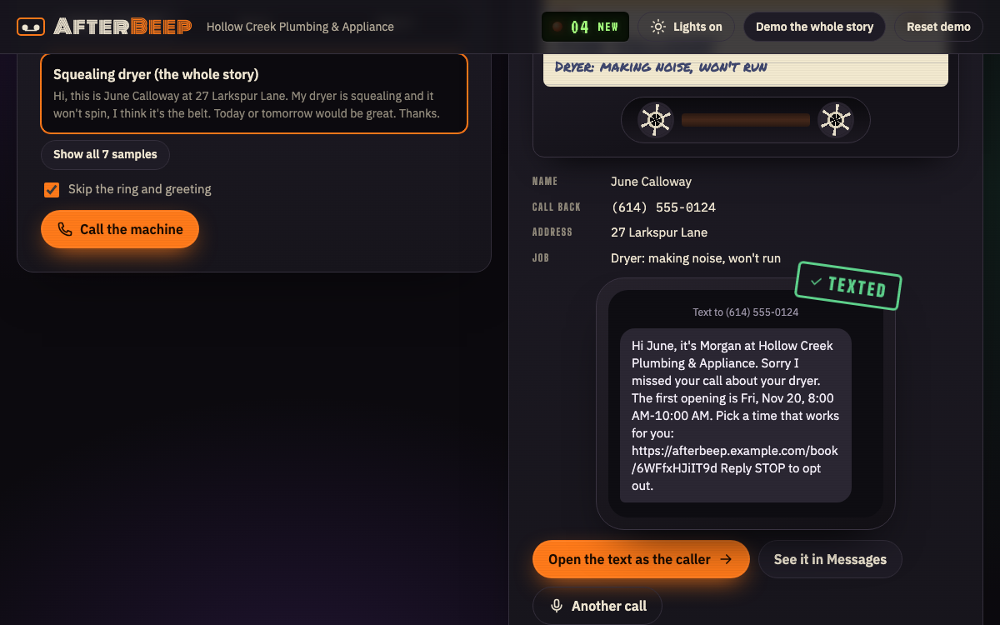
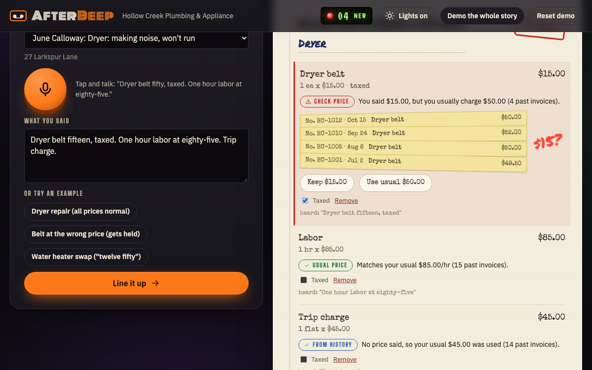
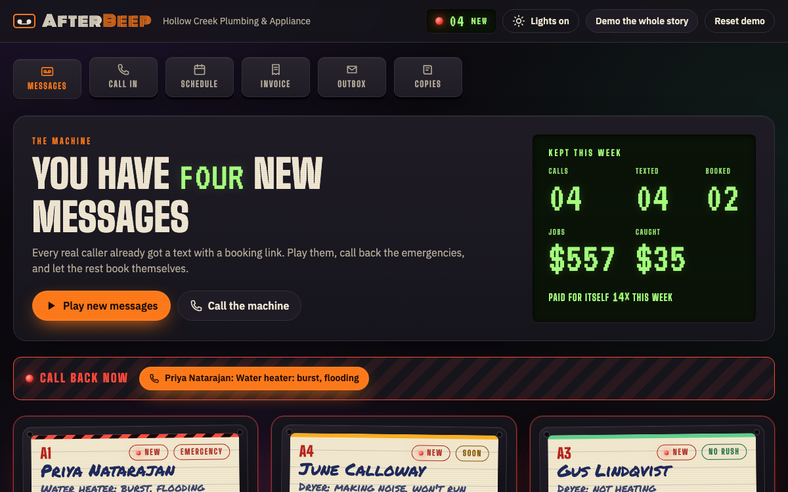
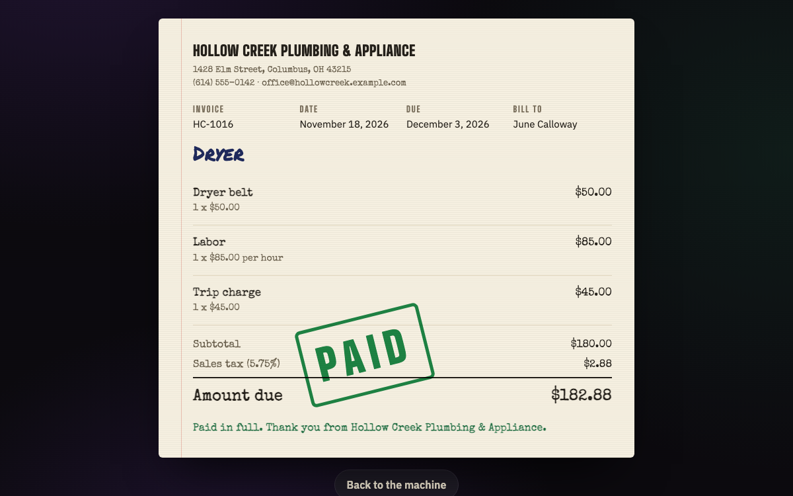
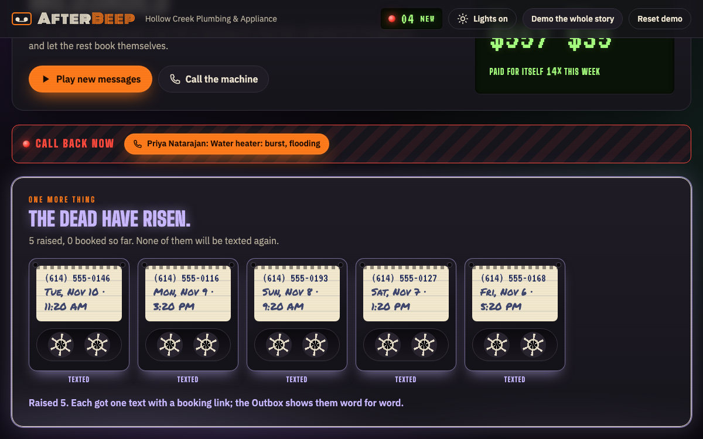

# AfterBeep

**Kiroween 2026 · Resurrection** · [](https://github.com/blackwingArtisan/afterbeep/actions/workflows/check.yml) · MIT

### The machine that hears fifteen and knows you meant fifty.

**AfterBeep answers the calls a one-person trade business misses, texts the caller a booking link, and won't let you bill $15 for a $50 part.** One plan, $39 a month.

|  |  |  |
|:---:|:---:|:---:|
| **The answering machine**<br>answers, reads and texts back | **The Dictaphone**<br>a spoken invoice becomes line items | **Carbon copies**<br>remember what you charge |

**What died.** A one-truck business used to run on three machines: an answering machine on the kitchen counter, a Dictaphone in the truck and a carbon-copy invoice book on the dash. The cell phone folded all three into a beep and a red badge. Voicemail promises the caller nothing, nobody types up the invoice until midnight, and there is no yellow copy to say what you charged last time. AfterBeep brings the three machines back, and this time they book the job and check the bill.

**Live demo:** link added at deploy · **Video:** link added at submission · **Judging?** [docs/judging.md](docs/judging.md) maps each criterion to its proof


## Try it in 60 seconds
Requires Node 24 or later. No accounts or keys.

1. `npm ci && npm run build && npm start`, then open http://localhost:3111.
2. On the landing page, press **Play** on the machine: it rings, types a burst water heater voicemail and shows the text the caller got back. Press **Bill** to see a misheard price held.
3. Press **Demo the whole story**. A call places itself and ends with June's tape and the exact text she was sent.
4. **Open the text as June**, pick a time, book.
5. **Back to Morgan: bill it by voice.** Line it up, use the usual $50.00, approve and send. The invoice is stamped SENT.
6. The story ends on a finale (1 booked, $182.88 billed, $35.00 caught). Press **Pay as June** and PAID slams onto her invoice.
7. **Back to the machine: raise the dead.** Last week's five hang-ups wait in the graveyard as ghost cassettes. One press texts each a booking link, and they rise.
8. Open **Messages**: "Kept this week" now reads Morgan's Tuesday: 2 booked, $557 of work, $35 caught, paid for itself 14 times.

## What a missed call costs

**Plain voicemail loses 69% of callers. AfterBeep's greeting promises a text with open times in seconds, so callers have a reason to stay**, and every one who leaves a message gets a booking link before they dial the next name on the list.

| | | Source |
|---|---|---|
| Callers who reach voicemail and hang up without a message | **69%** | Moneypenny call report, 2016 |
| Customers whose calls go unanswered who will not call back | **up to 85%** | CallRail small business benchmark, 1.1 million leads, 2025 |
| Home services calls that go unanswered | **14%** | CallRail, same benchmark |
| Typical minor appliance repair | **$206** | Thumbtack, 2026 |
| Typical emergency plumbing call | **$377** | Thumbtack, 2026 |
| US plumbing, HVAC and electrical contractors with no employees | **362,219**, up 10% since 2019 | US Census Bureau, Nonemployer Statistics 2023 |

**Payback, with the assumptions labelled.** Five missed calls a week is about 22 a month. Plain voicemail keeps 31% of them as messages. *Assume* a greeting that promises a text keeps half, and *assume* one in three of those callers books at Thumbtack's typical $206: that is about **$740 a month** of booked work, or **18 times** the $39 price. One booked job pays for five months. The landing page lets you move both assumptions.

**Morgan's Tuesday** (a scenario built on the demo data, so the app shows the same numbers). Morgan spends the afternoon under a water heater. Four calls roll to the machine, and every caller gets a text with open times in seconds. Priya's burst water heater books the first open slot at a $377 quote (Thumbtack's typical emergency plumbing call). June books a dryer visit, and that evening Morgan says "dryer belt, fifteen": the carbon copies hold it at the usual $50 and the bill goes out at $182.88. Kept this week: **2 jobs booked, $557 of work, $35 caught, paid for itself 14 times.** Run "Demo the whole story" and the inbox shows exactly that.

**Revenue at stake.** 362,219 solo building-equipment contractors at $468 a year is about **$170M a year**, before the 158,019 solo household repair shops (about $74M more) and the 1.93 million solo specialty trade contractors in NAICS 238 (about $900M) that miss calls the same way. The near-term goal is 1% of the first group: about $1.7M a year. Sources, assumptions and the full model: [docs/business.md](docs/business.md).

## Business

- **Price:** $39 a month, flat, 14-day free trial, no per-call or per-invoice fees.
- **Cost to serve on AWS:** about **$0.074 per call** (Connect, Transcribe, Bedrock Nova Lite, a two-segment text back and a confirmation) plus $3.90 a month for the number and 10DLC registration. Gross margin is **80% at 50 calls a month** and **52% at 200**. Texts are two-thirds of the cost, so shorter texts are the main lever.
- **Market:** about $170M a year across solo plumbing, HVAC and electrical contractors at $39 a month; 1% of them is about $1.7M a year.
- **Go to market:** no new number (conditional call forwarding on the phone they already carry), supply-house counter cards with a "call this and leave a message" QR code, trade forums, and a free month per referral.

## Why not iPhone Live Voicemail, Google Voice, Jobber, Podium or Smith.ai?

| Option | Price | What it leaves undone |
|---|---|---|
| iPhone Live Voicemail | Free | Shows the message; no text back, no booking, no invoice |
| Google Voice | $10-$30 per user a month | Transcribes; no booking link, no schedule, no price checks |
| Jobber | Core $29-$49 a month, AI Receptionist +$29 | A whole field-service suite to move into; invoices do not check a spoken price against your history |
| Podium | Quote from sales | Built for multi-location businesses |
| Smith.ai AI Receptionist | Free for 25 calls, then $150 a month for 75 | Priced per call, answers as a receptionist, no invoices |

A transcript is free now. What a solo tech still lacks is what happens after the beep: the text back, the booking, and a bill that cannot go out wrong.

## Screens

| Landing | The call | The hold |
|---|---|---|
|  |  |  |

| The caller's phone | Sent | The inbox |
|---|---|---|
|  |  |  |

| The finale | Paid | Raise the dead |
|---|---|---|
|  |  |  |

## What works today
Everything runs on a laptop with no accounts. Each item is covered by the tests below.

**The answering machine**
- Reads each voicemail for the caller's name, callback number (a spoken number beats caller ID), address, job and urgency. A furnace that quit at twenty degrees with a baby at home is an emergency; no hot water is "soon".
- Texts every real caller a booking link at once. Emergencies are promised a call back; everyone else sees the first open slot. Hang-ups get no text, a repeat caller gets one text per 10 minutes, and a text the carrier refuses is filed with a retry button.
- **Spanish callers.** A message left in Spanish is read for the same details, filed with an English job and summary and an ES chip, and the caller's text back and booking confirmation go out in Spanish. Try the "Burst water heater, in Spanish" sample in the call simulator.
- The booking page offers real open slots in the business's time zone, lets the caller correct the address, and texts a confirmation.
- The inbox shows each message as a cassette, emergencies first under a "Call back now" strip, with a seven-segment counter and a "Kept this week" readout.
- **Raise the dead.** Plain voicemail loses 69% of callers, and the ones who hang up without a word are the hardest to win back. Unreturned hang-ups from the last 30 days wait in a graveyard, one per number. One owner press texts each a single booking link that names the day they called; nothing goes out without the press, and a raised call is never texted twice.

**The Dictaphone and the carbon copies**
- "Dryer belt fifteen, taxed. One hour labor at eighty-five. Trip charge." becomes three lines. Code does every multiplication, the tax and the total in integer cents.
- The carbon copies, a price book built from past invoices, hold a price more than 15% below or 25% above the usual one, fills a missing price from history, reads "twelve fifty" as $1,250 for a water heater, and keeps "forty gallon" as a size, not a quantity.
- Quantities are checked too, and a price with two readings and no history waits for the owner to pick one.
- The server recomputes the total and sends only when it equals the exact total the owner approved.

## Architecture


Every outside service sits behind a port with a free local default, so the demo and all tests run with no accounts. The real adapters are type-checked and loaded only by environment variable.

| Port | Env var | Local (default) | Real |
|---|---|---|---|
| Transcriber | `AFTERBEEP_TRANSCRIBER` | `local`: the browser transcript | `aws`: Amazon Transcribe on the S3 recording |
| Extractor | `AFTERBEEP_EXTRACTOR` | `rules`: deterministic rules | `bedrock`: Bedrock Converse with a forced tool; drops any number or address the caller never said; falls back to rules |
| SMS | `AFTERBEEP_SMS` | `outbox`: shown at `/machine/outbox` | `aws`: AWS End User Messaging SMS |
| Invoices | `AFTERBEEP_INVOICES` | `local`: outbox message and `/i/:id` page | `stripe`: test keys only; voids the invoice if Stripe's total differs |
| Store | `AFTERBEEP_DATA_DIR` | JSON file with atomic writes | |

```
src/domain/     pure logic: money, spoken numbers, tax, invoice parser, price book (carbon copies), voicemail rules, Spanish glossary, slots, kept stats, graveyard, payback, story caller IDs
src/adapters/   ports and implementations: store, transcriber, extractor, sms, invoices
src/server/     Hono API, services (voicemail, booking, invoicing, revive), seed data
src/client/     React app: landing, machine (inbox, call, schedule, invoice, outbox, prices), caller pages
infra/          SAM template for the real phone path; connect/ holds the contact flow and Lambda
.kiro/          steering, specs, hooks, MCP settings
```

The phone wiring is in [infra/connect/README.md](infra/connect/README.md), and [infra/template.yaml](infra/template.yaml) deploys it with SAM; CI validates the template on every push. All settings are listed in `.env.example`.

## Tests and spec traceability

```bash
npm run check             # typecheck, spec coverage, 160 Vitest unit and API tests
npx playwright install chromium
npm run test:e2e          # 22 Playwright tests (one is phone-only) against the production build on port 3112
```

Every test title names the EARS requirements it proves, such as `[VI 3.4, 3.7] holds a labor rate well below the usual rate`. `npm run spec:coverage` fails the build when a requirement has no test: today 99 of 103 are named by tests, and the other 4 are on the real AWS and Stripe path. CI runs all of it on every push.

`npm run eval` scores the rules extractor on 24 hand-labelled voicemails it had not seen: on the first run it got every phone number and address right, never invented an address, and read urgency right in 19 of 24. The two missed emergencies it found are fixed, and urgency is now 21 of 24. Details and the remaining misses: [docs/eval.md](docs/eval.md). The same script scores Bedrock side by side with `--bedrock`, and `npm run test:aws` checks the live Bedrock path; both are paid, so both stay off unless you switch them on, and neither has been run for these numbers.

## Demo mode and deploy
The call simulator and **Reset demo** need no login, so they run only in demo mode. Demo mode is on by default while every adapter is local and turns off by itself when any real adapter is selected; set `AFTERBEEP_DEMO=off` before any deploy that holds real customer data. The owner screens have no login yet: this build is a single-tenant demo. `render.yaml` describes a one-service deploy with local adapters.

For development with hot reload: `npm run dev` (client on 3110, API on 3111).

## Built with Kiro
Kiro steering, specs, hooks and MCP settings live in [`.kiro/`](.kiro). [KIRO-LOG.md](KIRO-LOG.md) maps each Kiro feature to the files that use it and says which were written by Kiro and which by hand.

- **Steering:** product, tech and structure rules always included; money rules load with domain files and AWS rules with adapters; a manual demo script.
- **Specs:** two features in EARS form, 103 criteria, every task checked off and traced to tests. A Kiro review against the code added four criteria the code already met.
- **Hooks:** unit tests on save, a money-rules guard, spec sync, a copy review, and typecheck plus build checks when the agent stops.
- **MCP:** AWS documentation and Context7.

## License
MIT, Stubborn Otter Software. All people, businesses, addresses and phone numbers in the demo data are invented.
